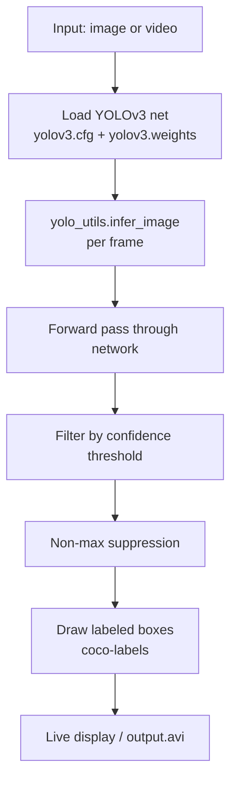

# IP (YOLOv3 Object Detection/Counting)

Python/OpenCV project that runs YOLOv3 on an image or video to detect and count objects from the COCO dataset.

## How it works

`yolo.py` is the CLI entry point: it loads the YOLOv3 network (`yolov3-coco/yolov3.cfg` + a separately-downloaded `yolov3.weights` file) via OpenCV's DNN module, then for each frame of the input image/video runs `yolo_utils.infer_image`, which forward-passes the frame through the network, applies non-max suppression on the resulting bounding boxes using the `--confidence`/`--threshold` cutoffs, and draws labeled boxes (from `coco-labels`) on the output. Results are shown live and/or written to `output.avi` for video input.



## Architecture

| File | Role |
|---|---|
| `yolo.py` | CLI entry point — argument parsing, model loading, frame loop |
| `yolo_utils.py` | Inference, NMS, and drawing helpers |
| `yolov3-coco/yolov3.cfg` | YOLOv3 network architecture config |
| `yolov3-coco/coco-labels` | COCO class label names |
| `yolov3-coco/get_model.sh` | Helper to fetch the (large, not committed) weights file |

## Tech stack

Python · OpenCV (`cv2.dnn`) · YOLOv3 / COCO

## Setup

```bash
pip install opencv-python numpy
# download yolov3.weights into yolov3-coco/ (see get_model.sh)
python yolo.py --video-path video.mp4 --video-output-path output.avi
```
